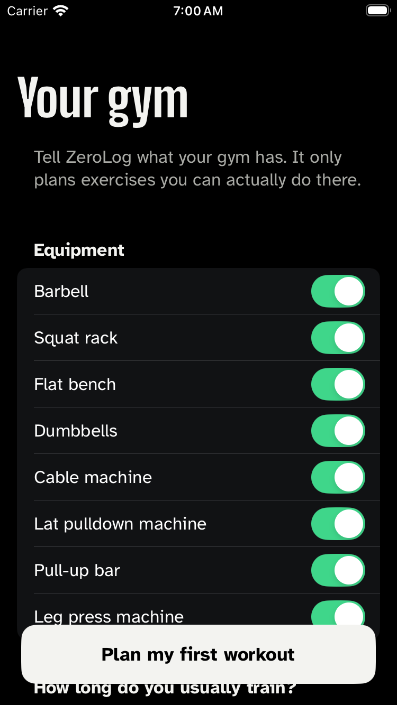
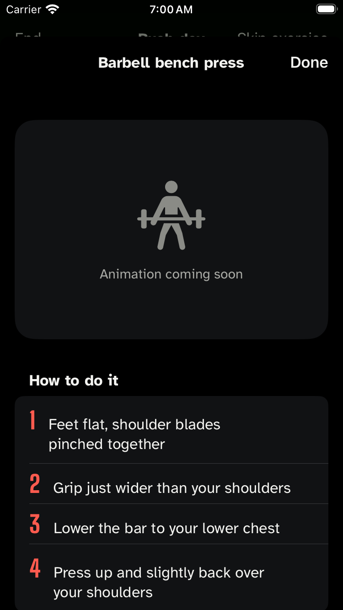
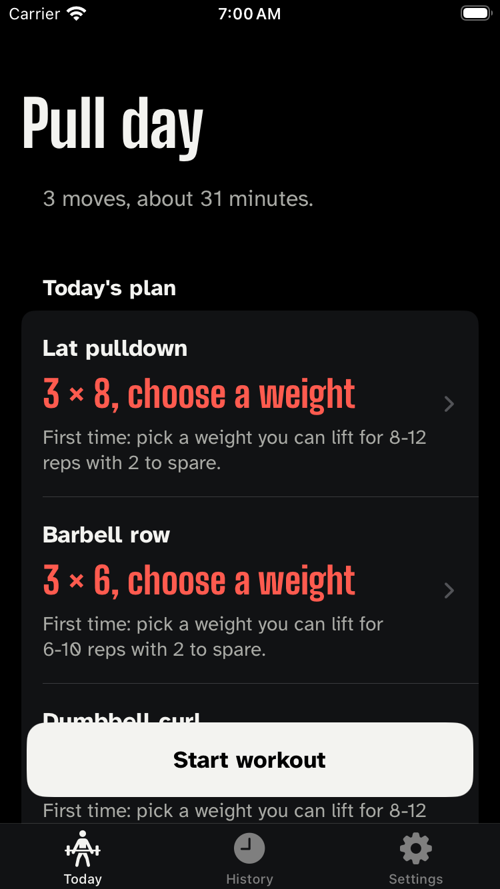
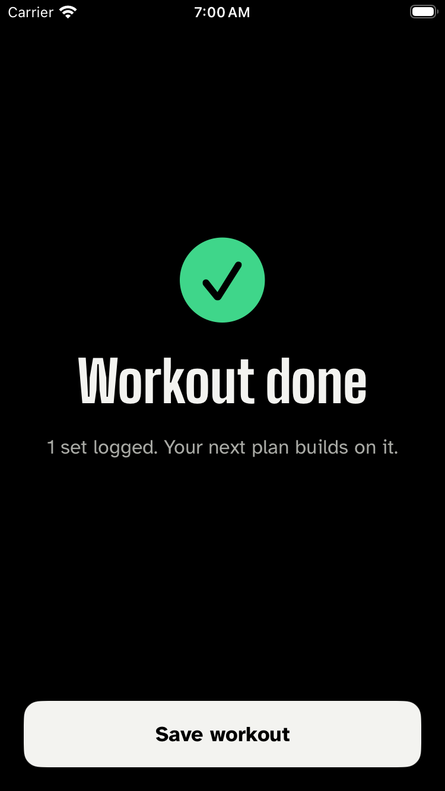
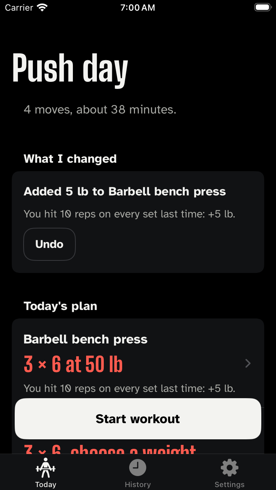
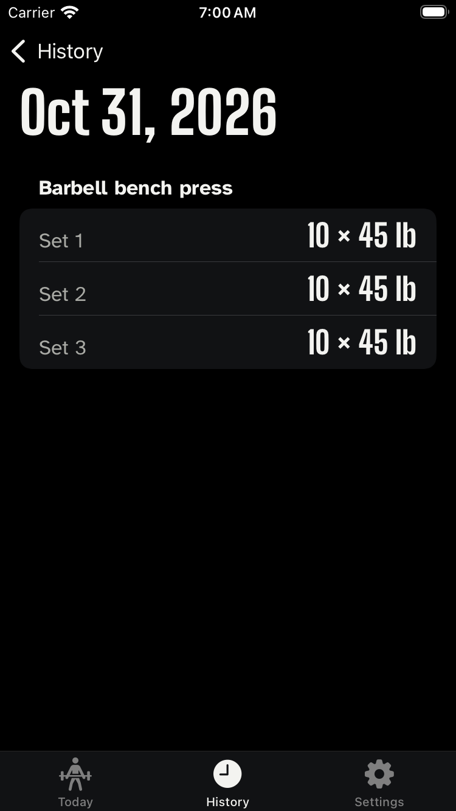

# ZeroLog, as it actually looks

Generated from commit `c62623c` on 2026-10-31 by `.github/workflows/screenshots.yml`.

Phone frames are captured from the host every 2 seconds while the UI tests drive the real app, with identical consecutive frames removed. Watch screens are each launched directly, because watchOS cannot be UI-tested; the plans shown come from the real engine, not mock-ups.

Video of the phone run (force-pushed to the `media` branch, newest only): [phone-tour.mp4](https://github.com/shaikqra/zerolog/raw/media/phone-tour.mp4)

## Apple Watch

### card

### consent

### diagnostics

### notsetup

### set

### start

### summary

## iPhone

### frame-00

### frame-03

### frame-06

### frame-17

### frame-18

### frame-19

### frame-20

### frame-21

### frame-22

### frame-23

### frame-43

### frame-65

### frame-79

### frame-80

### frame-81

### frame-82

### frame-83

### frame-84

### frame-85

### frame-86

### frame-87

### frame-88

### frame-89

