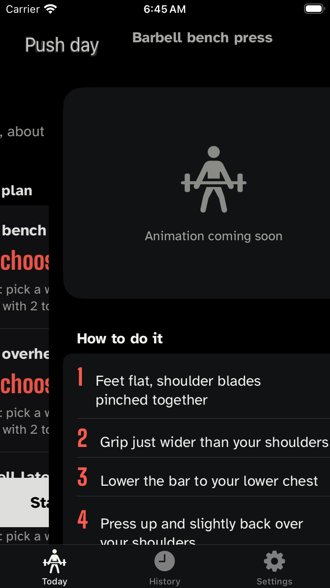
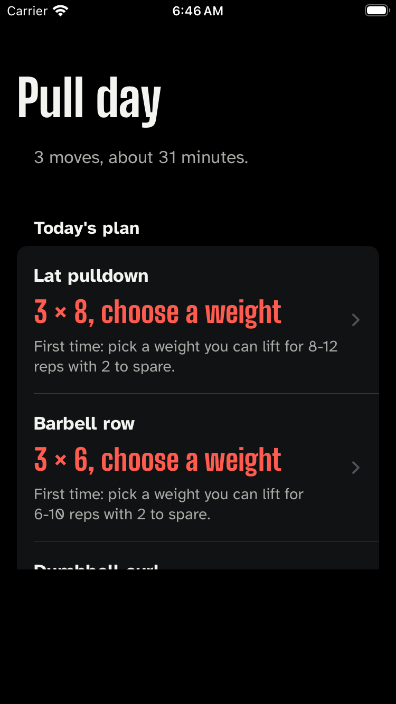
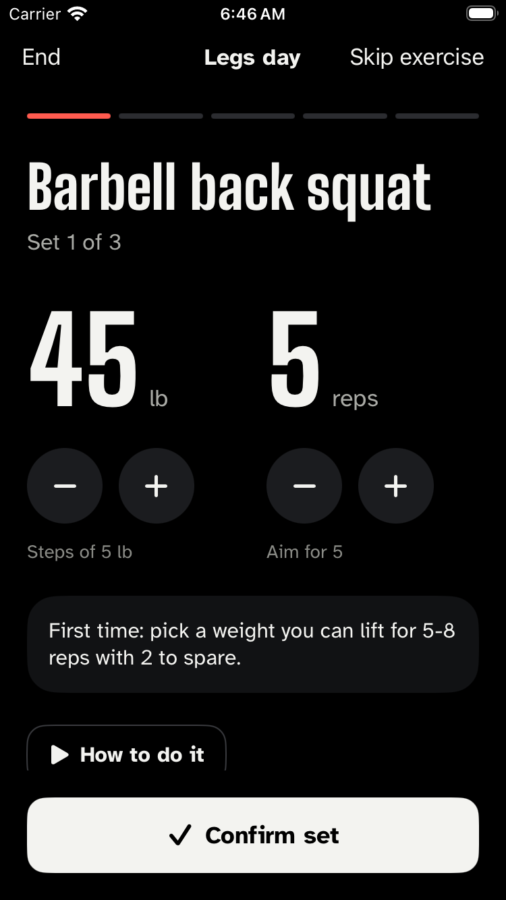
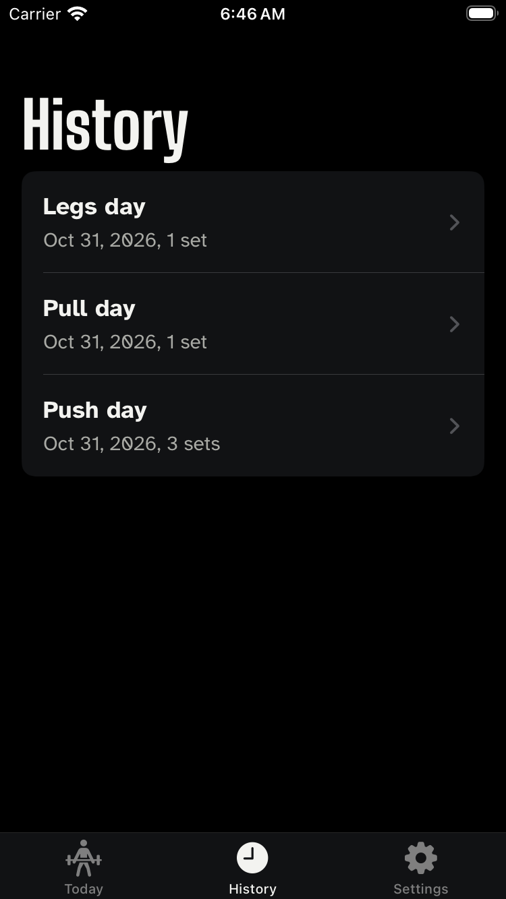

# ZeroLog, as it actually looks

Generated from commit `1e844d2` on 2026-10-31 by `.github/workflows/screenshots.yml`.

Phone frames are captured from the host every 2 seconds while the UI tests drive the real app, with identical consecutive frames removed. Watch screens are each launched directly, because watchOS cannot be UI-tested; the plans shown come from the real engine, not mock-ups.

Video of the phone run (force-pushed to the `media` branch, newest only): [phone-tour.mp4](https://github.com/shaikqra/zerolog/raw/media/phone-tour.mp4)

## Apple Watch

_Nothing captured this run._

## iPhone

### frame-00

### frame-09

### frame-20

### frame-21

### frame-38

### frame-61

### frame-67

### frame-68

### frame-69

### frame-70

### frame-71

