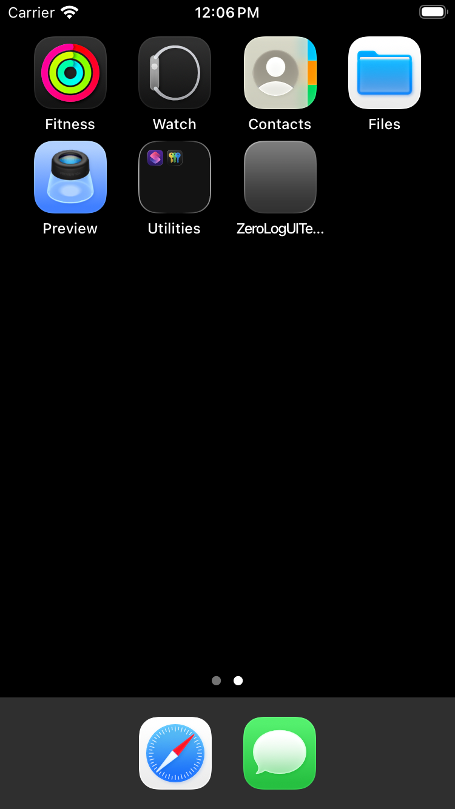
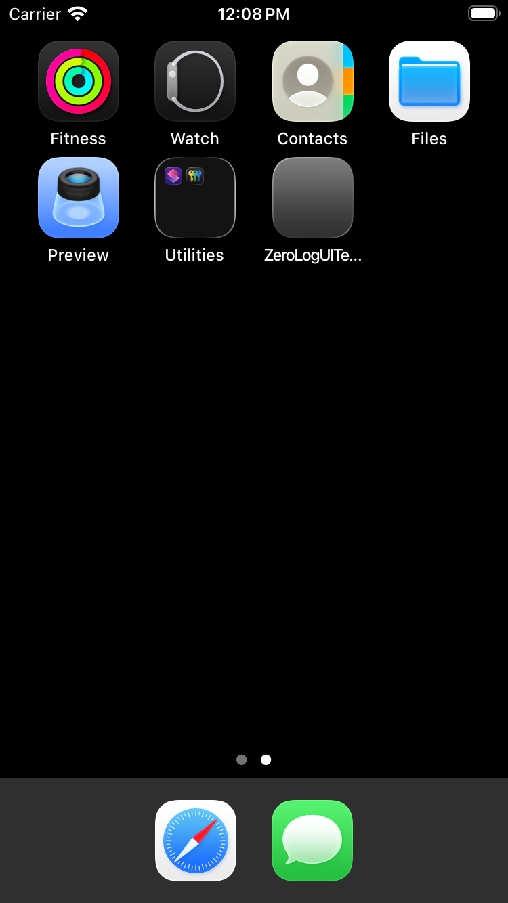

# ZeroLog, as it actually looks

Generated from commit `4408105` on 2026-11-06 by `.github/workflows/screenshots.yml`.

Phone frames are captured from the host every 2 seconds while the UI tests drive the real app, with identical consecutive frames removed. Watch screens are each launched directly, because watchOS cannot be UI-tested; the plans shown come from the real engine, not mock-ups.

Video of the phone run (force-pushed to the `media` branch, newest only): [phone-tour.mp4](https://github.com/shaikqra/zerolog/raw/media/phone-tour.mp4)

## Apple Watch

### card

### consent

### diagnostics

### dimmed

### notsetup

### selftest

### set

### start

### summary

## iPhone

### frame-00

### frame-01

### frame-05

### frame-18

### frame-24

### frame-29

### frame-45

### frame-65

### frame-84

