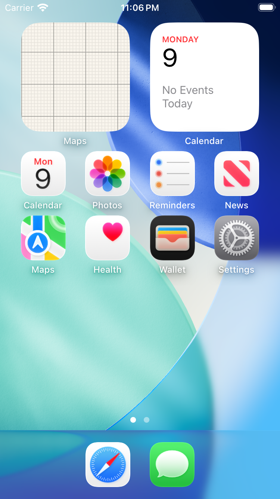

# ZeroLog, as it actually looks

Generated from commit `b55c68d` on 2026-11-09 by `.github/workflows/screenshots.yml`.

Phone frames are captured from the host every 2 seconds while the UI tests drive the real app, with identical consecutive frames removed. Watch screens are each launched directly, because watchOS cannot be UI-tested; the plans shown come from the real engine, not mock-ups.

Video of the phone run (force-pushed to the `media` branch, newest only): [phone-tour.mp4](https://github.com/shaikqra/zerolog/raw/media/phone-tour.mp4)

## Apple Watch

### card

### consent

### diagnostics

### dimmed

### notsetup

### set

### start

## iPhone

### frame-00

### frame-01

### frame-11

### frame-17

### frame-25

### frame-26

### frame-27

### frame-28

### frame-29

### frame-30

### frame-31

### frame-32

### frame-33

### frame-34

